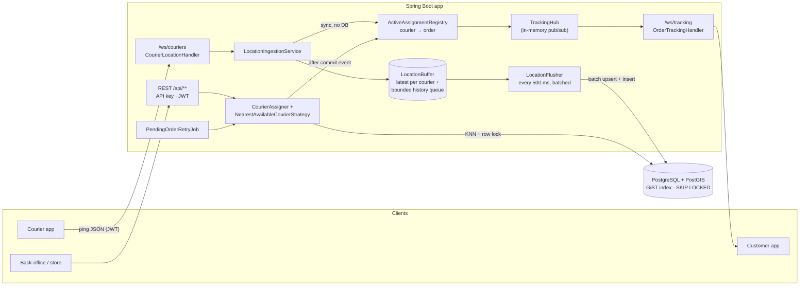
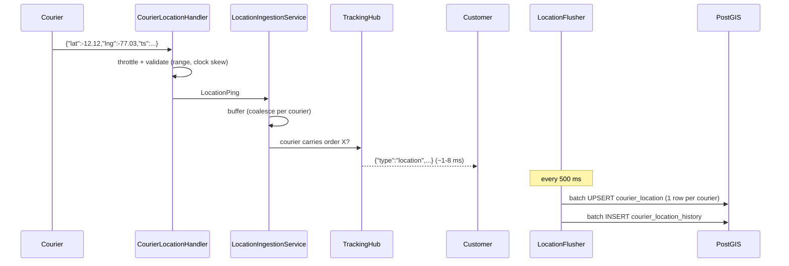
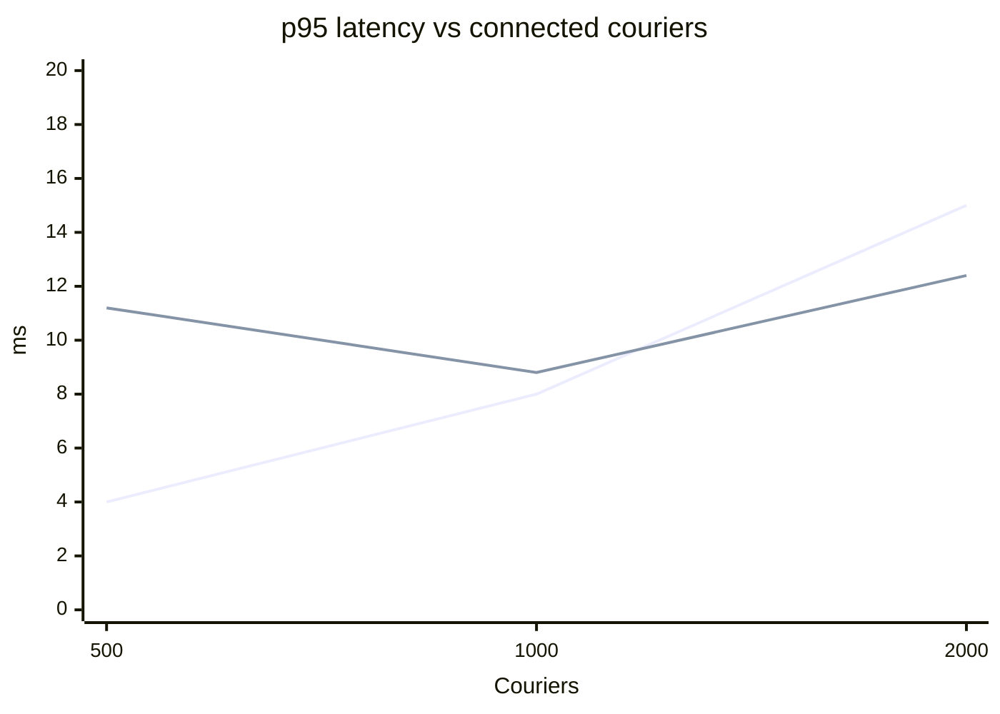

# Tracking Delivery

[](https://github.com/billyelcalvo/JavaTrackingDelivery/actions/workflows/ci.yml)


Backend de tracking de delivery en tiempo real. Los repartidores mandan su ubicación cada pocos segundos por WebSocket, el cliente ve el movimiento en vivo y cada pedido nuevo se asigna al repartidor disponible más cercano con una consulta KNN en PostGIS.

---

## El problema

Una app de delivery tiene dos tipos de tráfico que tiran en direcciones opuestas:

1. **Muchas escrituras pequeñas y constantes.** 1.000 repartidores mandando su posición cada segundo son 1.000 escrituras/s que no paran, aunque nadie las esté mirando.
2. **Lecturas que tienen que sentirse instantáneas.** El cliente quiere ver la moto moverse *ya*, y cuando entra un pedido hay que encontrar al repartidor libre más cercano sin asignárselo a dos pedidos a la vez.

Si cada ping va directo a la base, Postgres se convierte en el cuello de botella y la latencia que ve el cliente depende de lo rápido que escribe el disco. Este proyecto separa los dos caminos: el ping llega al cliente en memoria en milisegundos y la base recibe escrituras agrupadas en lotes.

## Arquitectura



### Recorrido de un ping



## Decisiones de diseño y trade-offs

| Decisión | Por qué | Lo que cuesta |
|---|---|---|
| **Write-behind con buffer en memoria** (`LocationBuffer` + `LocationFlusher`) | El ping no toca la base en el hot path. Si un courier manda 5 pings entre flushes, se escribe solo el último: como mucho 1 UPDATE por courier y por flush. | Si el proceso muere de golpe se pierden hasta ~500 ms de posiciones. En un apagado normal hay un flush final (`SmartLifecycle.stop`). |
| **Historial con cola acotada** (`ArrayBlockingQueue`) | Si la base se pone lenta, la memoria no crece sin límite. | Con la cola llena se descartan puntos del recorrido (se cuentan en `tracking.history.dropped`). La posición actual nunca se descarta. |
| **`courier_location` separada de `courier`** | El flusher actualiza posiciones todo el tiempo y la asignación bloquea filas de `courier`. En tablas separadas, una escritura de posición nunca bloquea ni hace saltar a un courier en la asignación. | Un JOIN más en la consulta de asignación. |
| **KNN con `<->` sobre `geography` + índice GiST** | Postgres recorre el índice por distancia en vez de calcularla para todos y ordenar. `ST_DWithin` pone un radio máximo. | Es distancia en línea recta, no por calles. Detrás de `AssignmentStrategy` se puede cambiar por ETA real. |
| **`FOR UPDATE ... SKIP LOCKED`** | Dos pedidos simultáneos no se quedan con el mismo courier: el segundo salta al siguiente candidato sin esperar. El job de reintento usa lo mismo, así que varias instancias pueden correrlo sin un lock distribuido. | Ver la nota de abajo sobre EvalPlanQual. |
| **CTE `MATERIALIZED` antes del lock** | Bloquear directo sobre el scan KNN falla bajo concurrencia (`failed to fetch tuple for EvalPlanQual recheck`). El CTE elige 20 candidatos sin lock y la consulta de afuera bloquea entre ellos, revisando `status` otra vez. Lo encontró `AssignmentIntegrationTest.concurrentOrdersNeverShareACourier`. | Si los 20 candidatos más cercanos se los llevan otros pedidos en el mismo instante, el pedido queda `PENDING` y lo toma el reintento (cada 5 s). |
| **Índice único parcial** `delivery_order (courier_id) WHERE status IN ('ASSIGNED','PICKED_UP')` | La base garantiza "un pedido activo por courier" aunque la aplicación tenga un bug. | Un índice más para mantener. |
| **WebSocket plano + JSON mínimo** (sin STOMP) | El protocolo es trivial (el courier envía, el cliente escucha) y cualquier cliente lo habla, incluido k6. | Sin broker no hay reintentos ni acks a nivel de protocolo: si el cliente se reconecta, recibe un snapshot y sigue. |
| **`ConcurrentWebSocketSessionDecorator` con `OverflowStrategy.DROP`** | Varios hilos escriben al mismo socket del cliente. Si su red es lenta, se descartan los mensajes viejos en vez de bloquear al courier. Para un punto en el mapa solo importa el último. | Un cliente lento puede saltarse posiciones intermedias. |
| **`TrackingHub` en memoria** | Cero dependencias extra y latencia de microsegundos en una sola instancia. | No escala horizontalmente tal cual: con varias instancias haría falta Redis pub/sub (o similar) detrás de la misma interfaz. |
| **JDBC (`JdbcClient`/`JdbcTemplate`) en vez de JPA** | Las consultas importantes son SQL de PostGIS con `SKIP LOCKED` y batch upserts. Así quedan explícitas y sin sorpresas del ORM. | Más SQL a mano y mapeo manual de filas. |
| **Máquina de estados en `OrderStatus`** | Las transiciones válidas viven en un solo lugar. Cada cambio es un `UPDATE ... WHERE status = :from`, así que dos actualizaciones concurrentes no se pisan. | Nada relevante. |
| **Auth simple: API key + JWT de courier** | Back-office con clave compartida (comparación en tiempo constante). El courier se identifica por el JWT del handshake, nunca por el body, así que no puede reportar la posición de otro. | El tracking del cliente solo exige conocer el UUID del pedido. Ver la sección de seguridad del código. |

## Stack

Java 21 · Spring Boot 3.5 (Web, WebSocket, JDBC, Validation, Actuator) · PostgreSQL 16 + PostGIS 3.5 · Flyway · Micrometer/Prometheus · springdoc-openapi · java-jwt · JUnit 5, Mockito, AssertJ, Testcontainers, Awaitility · JaCoCo · Spotless (google-java-format) · k6 · Docker · GitHub Actions · Render.

## Cómo correrlo

### Todo con un comando

```bash
cp .env.example .env        # opcional, hay valores por defecto para desarrollo
docker compose up --build
```

- API: http://localhost:8080
- Swagger UI: http://localhost:8080/swagger-ui.html
- Health: http://localhost:8080/actuator/health
- Métricas: http://localhost:8080/actuator/prometheus

La API key por defecto en compose es `local-dev-api-key`.

### Probar el flujo a mano

```bash
API=http://localhost:8080; KEY="X-API-Key: local-dev-api-key"

# 1. Registrar un courier (devuelve su JWT) y ponerlo disponible
TOKEN=$(curl -s -H "$KEY" -H 'Content-Type: application/json' \
  -d '{"name":"Ana"}' $API/api/couriers | jq -r .token)
curl -s -X PUT -H "Authorization: Bearer $TOKEN" -H 'Content-Type: application/json' \
  -d '{"status":"AVAILABLE"}' $API/api/me/status

# 2. El courier abre su WebSocket y manda posiciones
websocat "ws://localhost:8080/ws/couriers?token=$TOKEN"
{"lat":-12.1200,"lng":-77.0297}

# 3. Crear un pedido: se asigna al courier más cercano
curl -s -H "$KEY" -H 'Content-Type: application/json' \
  -d '{"pickup":{"lat":-12.1211,"lng":-77.0297},"dropoff":{"lat":-12.13,"lng":-77.02}}' \
  $API/api/orders

# 4. El cliente sigue el pedido en vivo
websocat "ws://localhost:8080/ws/tracking?orderId=<id>"
```

### Desarrollo y tests

```bash
./mvnw spotless:apply        # formato
./mvnw verify                # unit + integración (Testcontainers levanta PostGIS) + cobertura >= 70 %
```

Los tests de integración necesitan Docker corriendo. La imagen `imresamu/postgis` es el build multi-arquitectura de la imagen oficial de PostGIS, así que corre nativo en Macs ARM y en CI.

### Prueba de carga

```bash
docker compose up --build -d
./loadtest/run.sh                                  # 500, 1000 y 2000 couriers
LEVELS="1000" DURATION=5m ./loadtest/run.sh        # un nivel concreto
```

## API

### REST

| Método | Ruta | Auth | Qué hace |
|---|---|---|---|
| `POST` | `/api/couriers` | API key | Registra un courier y devuelve su JWT |
| `GET` | `/api/couriers/{id}` | API key | Detalle del courier |
| `GET` | `/api/couriers/nearby?lat&lng&radiusMeters&status&limit` | API key | Couriers cercanos, del más cercano al más lejano |
| `POST` | `/api/orders` | API key | Crea el pedido y lo asigna al más cercano (o queda `PENDING`) |
| `GET` | `/api/orders/{id}` | API key | Estado y última posición del courier |
| `POST` | `/api/orders/{id}/cancel` | API key | Cancela y libera al courier |
| `GET` | `/api/me` | JWT courier | Perfil del courier |
| `PUT` | `/api/me/status` | JWT courier | `AVAILABLE` / `OFFLINE` |
| `GET` | `/api/me/orders/current` | JWT courier | Pedido en curso (204 si no hay) |
| `POST` | `/api/me/orders/{id}/pickup` | JWT courier | Marca recogido |
| `POST` | `/api/me/orders/{id}/deliver` | JWT courier | Marca entregado; el courier vuelve a `AVAILABLE` |

La especificación completa está en `/v3/api-docs` y en Swagger UI. Los errores siguen RFC 7807 (`application/problem+json`): 400 por validación, 401 sin credenciales, 403 por un pedido ajeno, 404 si no existe y 409 por un conflicto de estado.

### WebSocket

OpenAPI no describe WebSockets, así que el protocolo va aquí:

**`/ws/couriers`**: el token va en el header `Authorization: Bearer <jwt>` o en `?token=<jwt>` (los navegadores no pueden poner headers en un WebSocket).

```jsonc
// courier -> server (ts opcional, epoch millis del dispositivo)
{"lat": -12.1205, "lng": -77.0297, "ts": 1792089300000}
// server -> courier, solo si el ping se rechaza
{"type": "error", "reason": "out_of_range" | "invalid_json" | "too_frequent" | "timestamp_in_future" | "timestamp_too_old" | "missing_coordinates"}
```

**`/ws/tracking?orderId=<uuid>`**: solo lectura. Al conectar llega un snapshot (estado + última posición) y después los cambios en vivo:

```jsonc
{"type":"status","orderId":"...","courierId":"...","status":"ASSIGNED","at":"2026-10-15T18:35:16Z"}
{"type":"location","orderId":"...","courierId":"...","lat":-12.1205,"lng":-77.0297,"at":"2026-10-15T18:35:17Z"}
```

Cuando el pedido termina (`DELIVERED` / `CANCELLED`) el servidor cierra el socket con código 1000.

## Configuración

Todo sale de variables de entorno (`application.yml`). Si falta `API_KEY` o `JWT_SECRET`, la app no arranca.

| Variable | Default | Descripción |
|---|---|---|
| `DATABASE_URL` | `jdbc:postgresql://${DATABASE_HOST}:${DATABASE_PORT}/${DATABASE_NAME}` | URL JDBC completa, o las piezas por separado |
| `DATABASE_USERNAME` / `DATABASE_PASSWORD` | `tracking` | Credenciales |
| `DATABASE_POOL_SIZE` | `10` | Tamaño del pool de Hikari |
| `API_KEY` | — (obligatoria) | Clave del back-office |
| `JWT_SECRET` | — (obligatoria, ≥ 32 chars) | Firma HS256 de los tokens de courier |
| `COURIER_TOKEN_TTL` | `12h` | Vigencia del token |
| `INGESTION_FLUSH_INTERVAL` | `500ms` | Cada cuánto se vacía el buffer a la base |
| `INGESTION_HISTORY_QUEUE_CAPACITY` | `200000` | Tope de puntos de historial en memoria |
| `INGESTION_MAX_BATCH_SIZE` | `5000` | Filas por batch de historial |
| `INGESTION_MIN_PING_INTERVAL` | `500ms` | Throttle por conexión |
| `ASSIGNMENT_SEARCH_RADIUS_METERS` | `5000` | Radio máximo de búsqueda |
| `ASSIGNMENT_LOCATION_FRESHNESS` | `60s` | Un courier sin pings en este tiempo no se asigna |
| `ASSIGNMENT_RETRY_INTERVAL` | `5s` | Reintento de pedidos `PENDING` |
| `WS_SEND_TIME_LIMIT` / `WS_SEND_BUFFER_LIMIT` | `5s` / `65536` | Límites por cliente lento |
| `WS_ALLOWED_ORIGINS` | `*` | Orígenes permitidos para el handshake |
| `LOG_FORMAT` | vacío (texto) | `ecs`, `logstash` o `gelf` para JSON |
| `SERVER_PORT` / `PORT` | `8080` | Puerto HTTP |

## Observabilidad

- **Logs estructurados**: con `LOG_FORMAT=ecs` cada línea es JSON y los ids van como campos propios (`orderId`, `courierId`, `status`) gracias a la API key-value de SLF4J, sin parsear texto.
- **Health checks**: `/actuator/health/liveness` y `/actuator/health/readiness`. El `HEALTHCHECK` del Dockerfile y Render usan readiness.
- **Métricas** (`/actuator/prometheus`): `tracking_pings_accepted_total`, `tracking_pings_rejected_total{reason}`, `tracking_history_dropped_total`, `tracking_buffer_latest`, `tracking_flush_duration_seconds`, `tracking_flush_failures_total`, `tracking_assignment_pick_seconds`, `tracking_assignment_result_total{outcome}` y `tracking_ws_sessions{type}`.
- **Migraciones**: Flyway, versionadas en `src/main/resources/db/migration` (`V1`…`V4`).

## CI/CD

`.github/workflows/ci.yml` corre en cada push y PR:

1. **lint**: `spotless:check` (google-java-format).
2. **test**: `./mvnw verify` con tests unitarios y de integración (Testcontainers) y el umbral de cobertura de JaCoCo (falla bajo 70 %). Sube los reportes como artifact.
3. **docker**: build de la imagen multi-stage con caché de GitHub Actions.

El despliegue está definido en `render.yaml` (Blueprint de Render: web service Docker + Postgres). Con `autoDeploy`, cada push a `main` despliega.

## Resultados

Medido con `loadtest/run.sh` contra el stack de `docker compose` en un Apple M2 (8 cores, 8 GB para la VM de Docker), con k6 en la misma máquina. Cada nivel: los couriers mandan un ping por segundo durante ~2 min 20 s mientras entran **20 pedidos/s**; cada pedido asignado abre un WebSocket de cliente 6 s y después se recoge y se entrega.

| Couriers conectados | Pings/s | Latencia courier → cliente p50 / p95 / p99 | `POST /api/orders` (incluye la asignación KNN) p50 / p95 / p99 | Pedidos asignados al instante | Flush a Postgres prom. / máx. | Errores HTTP |
|---:|---:|---|---|---:|---|---:|
| 500 | ~496 | 1 / 4 / 10 ms | 5.3 / 11.2 / 61.8 ms | 99.9 % | 8.7 / 41 ms | 0 % |
| 1.000 | ~993 | 1 / 8 / 13 ms | 4.3 / 8.8 / 16.9 ms | 99.6 % | 15.4 / 46 ms | 0 % |
| 2.000 | ~1.985 | 2 / 15 / 31 ms | 4.9 / 12.4 / 35 ms | 99.4 % | 29 / 94 ms | 0 % |



Cómo leerlo:

- **El flush crece de forma lineal y barata.** Con 1.000 couriers cada flush escribe ~455 filas de posición más el mismo número de historial en ~15 ms. Postgres pasa más del 95 % del tiempo sin trabajo de ingesta.
- **La asignación no se degrada con más couriers** porque el KNN sobre GiST lee solo los vecinos más cercanos, no la tabla entera.
- **El "1 %" que no se asigna al instante** son pedidos que llegan cuando sus candidatos cercanos están ocupados. El job de reintento los toma en ≤ 5 s.
- Parte de los pings enviados (8-20 % según la corrida) fueron rechazados por la validación del servidor (`tracking.pings.rejected{reason}`), lo que demuestra que el rechazo funciona bajo carga. Los números de pings/s son de pings enviados.

Otros números del proyecto:

| | |
|---|---|
| Tests | 90 (unitarios + integración con PostGIS real) |
| Cobertura de líneas / ramas | 97.5 % / 87.8 % (mínimo exigido en CI: 70 %) |
| Imagen Docker | ~105 MB (JRE 21 alpine, usuario no root, jar por capas) |
| Arranque de la app | ~1.7 s |
| Memoria de la app bajo carga (1.000 couriers) | ~380 MB RSS sin límite de heap |

Los JSON crudos de cada corrida están en `loadtest/results/`.

## Estructura

```
src/main/java/com/billyelcalvo/tracking
├── assignment/   AssignmentStrategy, NearestAvailableCourierStrategy, CourierAssigner,
│                 PendingOrderRetryJob, ActiveAssignmentRegistry
├── common/       GeoPoint, excepciones de dominio, GlobalExceptionHandler (RFC 7807)
├── config/       TrackingProperties (validadas al arrancar), OpenAPI, scheduling, Clock
├── courier/      registro, disponibilidad, búsqueda cercana + controllers
├── location/     LocationBuffer, LocationIngestionService, LocationFlusher, repositorio batch
├── order/        OrderStatus (máquina de estados), OrderService, repositorio + controllers
├── realtime/     handlers WebSocket, handshake interceptors, TrackingHub, PingValidator
└── security/     ApiKeyFilter, CourierAuthFilter, CourierTokenService (JWT)
```
